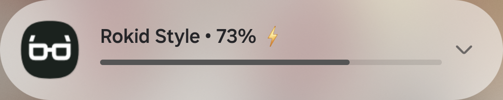
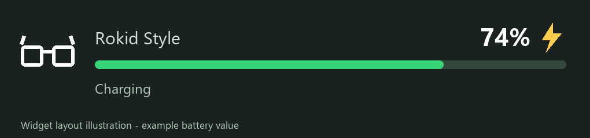

# Rokid Battery

**Your Rokid Style battery, at a glance.**

A lightweight, unofficial Android companion that shows the glasses' battery in an ongoing notification and an optional 4x1 home-screen widget. Tap either to open the official **Hi Rokid** app.

Created and hardware-tested by **[Tony Destin (@limmieo)](https://github.com/limmieo)**.



## Why I built it

I wanted to check how much battery my glasses had left, and whether they were charging, without opening Hi Rokid every time. This is the small companion I built for my own Rokid Style and Galaxy S24 FE.

This repository shares the implementation and what was tested. It does not distribute an APK.

## What it does

- Shows the battery percentage while the selected glasses are connected.
- Puts a lightning bolt beside the percentage when charging.
- Refreshes battery status every **30 seconds** while monitoring.
- Removes the notification on disconnect; reconnect requires a fresh reading.
- Opens the official Hi Rokid app when the notification or widget is tapped.
- Provides a slim, resizable **4x1 home-screen widget** with a glasses icon and green battery bar.
- Uses Hi Rokid's device-status interface instead of opening another glasses connection.



*The notification is an actual cropped phone screenshot. The widget above is a layout illustration, with an example reading and no personal phone wallpaper.*

## Tested hardware and software

| Component | Tested configuration |
| --- | --- |
| Glasses | Non-display Rokid AI Glasses Style |
| Phone | Samsung Galaxy S24 FE (SM-S721U) |
| Android | Android 16 / API 36, One UI 8 |
| Hi Rokid | Global package `com.rokid.sprite.global.aiapp`, version `G1.14.20.0921` |
| Glasses firmware | `1.26.009-20260917-151201` |
| Phone SDK dependency | Rokid CXR-L `com.rokid.cxr:client-l:1.0.4` |
| App source snapshot | Version 1.1.3, version code 5 |

Battery, charging, disconnect/reconnect and tap-to-open behavior were checked on this setup. Spotify, normal photo capture and Hi Rokid continued working during the short hardware tests. Those observations do not establish compatibility with other models, phones, or future Hi Rokid releases.

The current app requires **Android 16 or newer** and builds for **ARM64**. See [verification and limitations](docs/VERIFICATION.md) for the scope of testing.

## How it works

1. The user authorizes the companion through Hi Rokid.
2. Android's `CompanionDeviceManager` associates the companion with already-paired glasses. It does not create a new Bluetooth bond.
3. `CompanionDeviceService` handles background presence events.
4. The companion binds to Hi Rokid and registers only its device-status callback.
5. Explicit `getDeviceInfo()` requests refresh the battery every 30 seconds. Readings older than 90 seconds are hidden.

The status interfaces are shipped in Rokid's phone SDK, but this lower-level service contract is not guaranteed to remain stable. The app does not start audio, camera, AI or custom-view sessions, request audio focus, or open a direct RFCOMM/GATT connection.

**Why polling?** A callback-only test stayed at 86% while the actual battery changed. After normal requests resumed, a fresh request returned 94%. Callback-only operation was therefore not reliable enough on the tested Style setup.

## Build it locally

Requirements: JDK 17, Android SDK Platform 36 and Build Tools 36.0.0. Android Studio can install these SDK components. The Gradle wrapper is included; it uses Gradle 9.3.0 and Android Gradle Plugin 8.11.1.

Open the repository in Android Studio, or set `ANDROID_HOME` to your SDK directory. Alternatively, create your own ignored `local.properties` containing `sdk.dir` for your machine.

On Windows:

```powershell
.\gradlew.bat policyTest :app:assembleDebug :app:lintDebug
```

On macOS/Linux:

```sh
./gradlew policyTest :app:assembleDebug :app:lintDebug
```

Gradle resolves Rokid CXR-L from the vendor's Maven repository configured in `settings.gradle`. Vendor SDK binaries, the official Hi Rokid app, authorization tokens and signing keys are not included in this repository. Vendor repository availability and SDK terms still apply.

Debug builds use your machine's own debug signing key. Release builds are intentionally unsigned until you configure your own signing. A build made with a different key cannot update an existing installation signed by another key; do not uninstall an existing installation without considering its setup data.

## Setup on the phone

1. Install the official global Hi Rokid app and pair/connect your Style normally.
2. Install your locally built companion and open **Rokid Battery**.
3. Tap **Set up / resume**, allow notifications and nearby-device access, and approve Hi Rokid authorization.
4. Confirm your already-paired glasses in Android's companion dialog.
5. Optionally tap **Add battery widget** to add the home-screen widget.

**Stop monitoring** removes this companion's association and clears its notification. It does not unpair the glasses from Bluetooth or remove Hi Rokid's own pairing.

## Permissions and privacy

The app requests notifications, nearby-device access, and Android companion background/presence permissions. It also requests promoted-notification treatment, which the phone may ignore.

There are no app permissions for internet, location, microphone, camera, storage, accessibility or notification-listener access. Hi Rokid retains its own normal behavior and permissions. The companion stores the authorization token in app-private preferences, disables backup/transfer of that data, and does not log the token itself. The vendor SDK may have its own logging behavior; do not publish raw logs.

## Known limits

- Android and Samsung control notification ordering. An ongoing notification is not a guarantee of top placement, Now Bar support or immunity from dismissal.
- Lock-screen notification appearance depends on phone settings. **Lock-screen widget placement has not been qualified.**
- Widgets may retain a rendered reading if Android stops the process; the report time makes the last update visible.
- Long-duration battery drain, reboot recovery and other hardware/firmware combinations have not been comprehensively tested.
- No quantified battery-saving or zero-drain claim is made.

## Credit and feedback

Designed and developed by **Tony Destin**, with physical testing on his own glasses and phone. If you discuss or demonstrate the project, please link back to this repository so the original work is easy to find.

For feedback or a potential collaboration, [open an issue](https://github.com/limmieo/rokid-battery/issues). Share model/version details and a description, but not tokens, serial numbers, Bluetooth addresses, or full diagnostic logs.

**This is an independent personal project, not an official Rokid product or an endorsed integration.** Rokid and Hi Rokid names belong to their respective owners. See [third-party notices and source rights](NOTICE.md).
